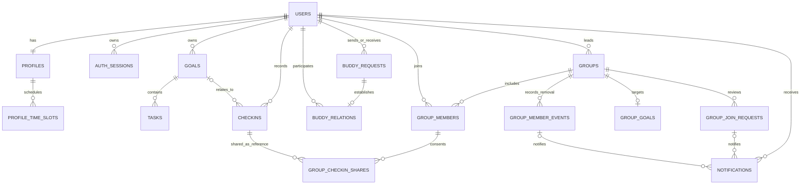

# 学搭数据库设计（PostgreSQL）

> 当前 Alembic 版本：`20261113_0005`
> 已落地：账号、真实学习档案与每周时段、会话、登录限流、目标、任务、打卡、搭子邀请/关系/通知，以及小组、成员、审核、共同目标与显式打卡分享
> 约束：前端不得直接连接 PostgreSQL，所有读写必须经过 FastAPI 身份与所有权校验

## 1. 设计原则

1. 业务主键使用 UUID，不暴露连续用户或业务量。
2. 时间字段使用带时区时间并按 UTC 存储；学习日期使用 `date`。
3. 密码只存 Argon2id 哈希；会话只存随机令牌的 SHA-256 哈希。
4. 唯一约束、外键和必要检查约束在数据库层兜底，不只依赖前端。
5. 使用 Alembic 管理 schema；生产环境 `STUDYMATE_AUTO_CREATE_SCHEMA=false`。
6. 旧库升级不清空用户或业务数据；当前 downgrade 故意不自动删除认证表。

## 2. 已实现关系



`login_throttles` 是独立风控表，主键为签名密钥、客户端 IP 和规范化账号组合后的哈希，不直接保存 IP 或账号原文。

## 3. 已实现表

### 3.1 `users` — 账号主体

| 字段 | PostgreSQL 类型 | 约束/说明 |
| --- | --- | --- |
| `id` | `uuid` | PK |
| `username` | `varchar(32)` | 可空是为了旧库无损迁移；新账号必填且唯一 |
| `email` | `varchar(320)` | 新账号必填且唯一，应用层转小写 |
| `phone` | `varchar(32)` | 可空，本版未使用 |
| `password_hash` | `text` | 新账号必填，Argon2id PHC 字符串，绝不存明文 |
| `status` | `varchar(20)` | 当前使用 `active` |
| `is_active` | `boolean` | 非空，禁用账号无法建立/使用会话 |
| `last_login_at` | `timestamptz` | 可空 |
| `created_at/updated_at` | `timestamptz` | 非空 |

唯一约束：`username`、`email`。重复检查与数据库唯一约束同时存在，处理并发注册竞争。

### 3.2 `profiles` — 学习档案

| 字段 | 类型 | 约束/说明 |
| --- | --- | --- |
| `user_id` | `uuid` | PK + FK → `users.id`，`ON DELETE CASCADE` |
| `display_name` | `varchar(50)` | 非空，注册时初始为用户名 |
| `avatar_url` | `text` | 可空 |
| `timezone_name` | `varchar(64)` | 默认 `Asia/Shanghai` |
| `onboarding_completed` | `boolean` | 非空，默认 false |
| `school/major` | `varchar(100)` | 默认空，只有本人档案 API 可见 |
| `bio` | `varchar(300)` | 默认空，只有本人可见，不进入推荐响应 |
| `categories` | `json` | 非空数组，最多 8 个预设方向 |
| `tags` | `json` | 最多 20 个目标标签，每项 1–32 字；匹配时去空白、转小写、去重 |
| `styles` | `json` | 非空数组，最多 8 个预设学习方式 |
| `stage` | `varchar(20)` | 可空，入门/基础/强化/冲刺 |
| `daily_target_minutes` | `integer` | CHECK 30–720，默认 180 |
| `matching_enabled` | `boolean` | 默认 false，只有主动开启才成为推荐候选 |
| `allow_invites` | `boolean` | 默认 false；与 matching_enabled 同时开启才可接收新邀请 |
| `created_at/updated_at` | `timestamptz` | 非空 |

索引：`(matching_enabled, user_id)`。当前使用 SQLAlchemy `JSON`，在 PostgreSQL 中实际为 `json`，不依赖 SQLite 模拟。

方向、标签和方式为小型受控数组，当前不单独建多对多表；推荐只读取本人主动填写的匹配资料，不关联私有 `goals/tasks/checkins`。读取本人档案和修改档案的路由固定为 `/profiles/me`，不接受客户端 `userId`。

### 3.2.1 `profile_time_slots` — 每周可用时间

| 字段 | 类型 | 约束/说明 |
| --- | --- | --- |
| `id` | `uuid` | PK，服务端生成 |
| `user_id` | `uuid` | FK → profiles.user_id，ON DELETE CASCADE |
| `day` | `integer` | CHECK 1–7，周一至周日 |
| `start_minute` | `integer` | 当日 00:00 起的分钟数，至少 0 |
| `end_minute` | `integer` | 至多 1440，严格大于 start_minute |

唯一约束：`(user_id, day, start_minute, end_minute)`；索引：`(user_id, day)`。每人 API 上限 42 个时段。自身重叠时段允许保存，算法会合并，不能重复增加重合分。跨午夜须拆为两天，结束时间可以为 `24:00`。

本阶段支持 `Asia/Shanghai`、`Asia/Hong_Kong`，均按北京时间 UTC+8 比较；其他时区的历史档案不进入候选池，本人需先更新时区。未实现夏令时地区的跨时区匹配。

推荐只返回白名单：公开 UUID、昵称、头像首字、方向、目标标签、方式、阶段、时区、星期/时段及评分解释。不会返回邮箱、学校、专业、简介、密码哈希、会话、在线状态、打卡统计或私人记录。

### 3.3 `auth_sessions` — 登录会话

| 字段 | 类型 | 约束/说明 |
| --- | --- | --- |
| `id` | `uuid` | PK |
| `user_id` | `uuid` | FK → `users.id`，`ON DELETE CASCADE` |
| `token_hash` | `varchar(64)` | 唯一，只存 SHA-256 哈希 |
| `expires_at` | `timestamptz` | 非空 |
| `revoked_at` | `timestamptz` | 退出后写入，可空 |
| `created_at` | `timestamptz` | 非空 |

索引：`(user_id, revoked_at)`、`expires_at`、`UNIQUE(token_hash)`。

### 3.4 `login_throttles` — 登录失败限流

| 字段 | 类型 | 说明 |
| --- | --- | --- |
| `key_hash` | `varchar(64)` | PK，不存原始 IP/账号 |
| `failure_count` | `integer` | 当前窗口失败数 |
| `window_started_at` | `timestamptz` | 计数窗口起点 |
| `locked_until` | `timestamptz` | 锁定结束时间，可空 |
| `updated_at` | `timestamptz` | 非空 |

成功登录删除对应限流记录。多进程部署时仍使用同一 PostgreSQL，不依赖单进程内存。

### 3.5 `goals` — 学习目标

| 字段 | 类型 | 约束/说明 |
| --- | --- | --- |
| `id` | `uuid` | PK |
| `user_id` | `uuid` | FK → users，级联删除，所有权根 |
| `title` | `varchar(100)` | 非空 |
| `description` | `text` | 非空，可为空字符串 |
| `category` | `varchar(40)` | 非空，当前与前端预设分类对齐 |
| `tags` | `jsonb/json` | 非空字符串数组 |
| `start_date/target_date` | `date` | `target_date >= start_date` |
| `status` | `varchar(20)` | `进行中/已完成/已暂停` |
| `color` | `varchar(7)` | API 校验 `#RRGGBB` |
| `created_at/updated_at` | `timestamptz` | 非空 |

索引：`user_id`、`(user_id, status, target_date)`。

### 3.6 `tasks` — 目标任务

| 字段 | 类型 | 约束/说明 |
| --- | --- | --- |
| `id` | `uuid` | PK |
| `goal_id` | `uuid` | FK → goals，`ON DELETE CASCADE` |
| `title` | `varchar(200)` | 非空 |
| `due_date` | `date` | 非空 |
| `estimated_minutes` | `integer` | API 限制 1–1440 |
| `completed` | `boolean` | 默认 false |
| `completed_at` | `timestamptz` | 完成时写入，取消完成时置空 |
| `created_at/updated_at` | `timestamptz` | 非空 |

索引：`goal_id`。任务所有权通过 `tasks.goal_id -> goals.user_id` 校验。

### 3.7 `checkins` — 学习打卡

| 字段 | 类型 | 约束/说明 |
| --- | --- | --- |
| `id` | `uuid` | PK |
| `user_id` | `uuid` | FK → users，级联删除，所有权根 |
| `goal_id` | `uuid` | 可空，FK → goals，`ON DELETE SET NULL` |
| `study_date` | `date` | 非空，API 禁止未来日期 |
| `duration_minutes` | `integer` | CHECK 1–1440 |
| `content` | `varchar(1000)` | 非空 |
| `mood` | `varchar(30)` | 非空 |
| `created_at/updated_at` | `timestamptz` | 非空 |

索引：`user_id`、`(user_id, study_date)`。允许同一天多条记录。

### 3.8 `buddy_requests` — 邀请及处理历史

| 字段 | PostgreSQL 类型 | 说明 |
| --- | --- | --- |
| `id` | uuid | PK |
| `sender_id/recipient_id` | uuid | 非空 FK → users.id，ON DELETE CASCADE，禁止相同 |
| `user_low_id/user_high_id` | uuid | 非空 FK → users.id，按 UUID 升序规范化，CHECK low < high |
| `message` | varchar(200) | 用户留言，可空字符串，不进入站内通知正文 |
| `status` | varchar(16) | CHECK pending/accepted/rejected/cancelled |
| `created_at/updated_at` | timestamptz | 非空，UTC |
| `resolved_at` | timestamptz | 处理后写入 |

CHECK 保证 sender/recipient 必须恰为规范化的两位参与者。部分唯一索引 `uq_buddy_request_pending_pair (user_low_id,user_high_id) WHERE status='pending'` 防止 A→B 与 B→A 同时出现待处理邀请。索引 `(sender_id,created_at)` 支撑滚动发送限流；`(recipient_id,status,created_at)` 支撑收件箱。终态历史保留，过冷却期后可重新申请，不覆盖旧记录。

### 3.9 `buddy_relations` — 正式搭子关系

| 字段 | 类型 | 说明 |
| --- | --- | --- |
| `id` | uuid | PK |
| `user_low_id/user_high_id` | uuid | FK → users，CHECK low < high，ON DELETE CASCADE |
| `source_request_id` | uuid | UNIQUE、FK → buddy_requests.id，ON DELETE SET NULL |
| `created_at` | timestamptz | 非空 |
| `ended_at` | timestamptz | null 表示有效关系 |
| `ended_by` | uuid | 可空 FK → users，CHECK 为本关系参与者，ON DELETE SET NULL |

部分唯一索引 `uq_buddy_relation_active_pair (user_low_id,user_high_id) WHERE ended_at IS NULL` 保证任意一对用户只有一条有效关系；另有 `(user_low_id,ended_at)`、`(user_high_id,ended_at)`。解除是软结束，保留历史，不删除双方目标或打卡。重新建立需新的明确邀请与新的关系 ID，不能再次接受旧的已结束邀请来复活关系。

### 3.10 `notifications` — 私有站内通知

| 字段 | 类型 | 说明 |
| --- | --- | --- |
| `id` | uuid | PK |
| `user_id` | uuid | 通知接收者，FK → users，ON DELETE CASCADE |
| `actor_id` | uuid | 触发者，FK → users，可空，ON DELETE SET NULL |
| `request_id/relation_id` | uuid | 可空 FK → 相应业务表，ON DELETE SET NULL |
| `group_id` | uuid | 可空FK→groups，SET NULL |
| `group_request_id` | uuid | 可空FK→group_join_requests，SET NULL |
| `group_event_id` | uuid | 可空FK→group_member_events，SET NULL |
| `kind` | varchar(40) | CHECK四种搭子事件+四种小组事件 |
| `event_key` | varchar(140) | UNIQUE，事件类型+实体ID+接收者，用于防重复，API 不返回 |
| `created_at/read_at` | timestamptz | 已读时间可空 |

索引 `(user_id,read_at,created_at)`。八类事件、关联与接收者见API文档。新增小组申请、通过、拒绝、移除；标题由固定kind生成。group_request_id关联真实申请，移除因成员行被删除，另以group_event_id关联持久业务来源。事件键为kind+来源UUID+接收者，数据库唯一；不保存私人目标、打卡、邮箱或邀请留言快照。业务与通知一次提交，失败共同回滚。read-all使用单条UPDATE限定user_id及read_at IS NULL，不跨账号、保留首次已读时间，后续新事件仍未读。

### 3.11 `groups` — 真实学习小组

| 字段 | 类型 | 约束/说明 |
| --- | --- | --- |
| id | uuid | PK |
| owner_id | uuid | FK users，RESTRICT；通过转让维护，与 owner 成员同事务创建 |
| name/category | varchar(50)/varchar(40) | 非空，预设方向由 API 验证 |
| description/announcement | varchar(500) | 非空；简介公开发现，公告仅组员可见 |
| tags | json | 非空数组，API 最多10项 |
| max_members | integer | CHECK 2–200，事务内校验当前人数 |
| requires_approval | boolean | 是否审核，非空 |
| created_at/updated_at | timestamptz | 非空 |
| archived_at | timestamptz | null为有效小组，解散时软归档 |

索引 `(archived_at,category,created_at)`；部分唯一 `(owner_id,name) WHERE archived_at IS NULL`，同一组长有效小组同名重复提交返回409。没有自动导入旧 LocalStorage 演示数据。

### 3.12 `group_join_requests` — 加入审核历史

id uuid PK；group_id/user_id uuid FK→groups/users CASCADE；status varchar(16) CHECK pending/approved/rejected/cancelled；created_at非空、resolved_at可空 timestamptz；resolved_by uuid可空 FK users SET NULL。

部分唯一 `(group_id,user_id) WHERE status='pending'`；索引 `(group_id,status,created_at)`、`(user_id,created_at)`。保留终态，不把拒绝/退出后重新发起的申请覆盖旧行。申请者只能取消自己的 pending，组长可批准/拒绝。

### 3.13 `group_members` — 当前有效成员

复合 PK `(group_id,user_id)`，分别 FK groups/users CASCADE；role varchar(16) CHECK owner/member；joined_at timestamptz非空；source_request_id uuid可空 UNIQUE、FK group_join_requests SET NULL。直接加入和创建者无来源申请。

部分唯一 `(group_id) WHERE role='owner'` 保证最多一个组长；索引 `(user_id,joined_at)`。创建者与 owner 行同事务，转让先降级原组长并 flush 再升级现有成员，组长不可直接退出/被移除。申请审批的幂等还校验 source_request_id，避免旧批准记录在退出后复活成员。

### 3.14 `group_goals` — 当前共同目标

id uuid PK；group_id uuid UNIQUE FK groups CASCADE；title varchar(120)；start_date/end_date date CHECK end>=start；target_minutes integer CHECK 1–525600；created_by uuid可空 FK users SET NULL；created_at/updated_at timestamptz。API额外约束周期<=366天、目标<=周期天数×1440。

一组一个当前目标，owner PUT新增/更新；未保存历史目标版本。成员进度从其本组有效分享 JOIN现有checkins按周期聚合，不新增可由客户端提交的完成分数。

### 3.15 `group_checkin_shares` — 最小授权关联

| 字段 | 类型 | 约束/说明 |
| --- | --- | --- |
| group_id/checkin_id | uuid | 复合PK，原记录每组仅计一次 |
| user_id | uuid | 非空，必须同时是成员和原打卡所有者 |
| share_content | boolean | 非空，默认false，正文需单独授权 |
| shared_at | timestamptz | 非空，重复PUT保留首次时间 |

复合外键 `(group_id,user_id)→group_members(group_id,user_id)` CASCADE；`(checkin_id,user_id)→checkins(id,user_id)` CASCADE。为后者在 checkins 新增 `UNIQUE(id,user_id)`，不改变旧个人数据归属。

索引 `(group_id,shared_at)`、`(checkin_id,user_id)`。不复制学习正文、时长、心情、私人目标或身份信息。退出/移除删除成员时级联撤回分享；解散删除所有成员和分享，保留小组归档、目标和审核历史；删除原打卡级联删除其所有组分享；撤回分享不影响原打卡。重新加入不会恢复旧分享。

仅组员可读取显式分享，SQL使用CASE在未授权时返回content=null。全部统计JOIN当前成员、有效用户、现有checkins、唯一分享，过滤未来日期和早于本次加入UTC+8日期的数据。统计周期、排序及每日1440分钟限制见API文档。事务先锁group再锁个人checkin，容量检查与变更均在group锁内；成员私有读取用共享锁，撤回成员与新增分享不会留下孤立记录。

### 3.16 `group_member_events` — 成员移除业务来源

id uuid PK；group_id/user_id uuid分别FK groups/users CASCADE；actor_id uuid可空FK users SET NULL；membership_joined_at timestamptz非空；kind varchar(16) CHECK removed；created_at timestamptz非空。UNIQUE(group_id,user_id,membership_joined_at)保证一次有效成员关系只记录一次移除；重新加入再被移除是新事件。

该表不提供前端任意写入API。组长移除成员时，在同一group锁和事务内保存事件、删除有效成员/其分享并通知被移除者。重复DELETE找不到成员则204，不生成新事件。通知保留与小组/移除事件的关联，但不会恢复成员权限；正文只提供最小公开资料。

## 4. 所有权与删除语义

- 目标：查询必须同时带 `goals.id` 和 `goals.user_id == current_user.id`。
- 任务：通过 join goals 确认当前用户拥有所属目标。
- 打卡：查询/删除必须带 `checkins.user_id`；关联目标也必须属于当前用户。
- 删除目标级联删除其任务，已有打卡的 `goal_id` 置空，打卡历史保留。
- 对其他用户的资源返回 404，不返回“存在但禁止”以减少资源枚举。
- 档案保存用当前会话用户 ID，并在事务内锁定本人档案、替换本人时段；校验失败不修改已有数据。
- 邀请仅双方可读：接受/拒绝仅 recipient，取消仅 sender；其他身份和错误角色统一 404。
- 有效关系仅双方可查看/解除；通知仅接收者可读和标记已读。
- 小组公开摘要仅用于发现，成员/公告/动态/榜单/共同目标仅组员可见，非成员404；组员越权管理403。组长拥有审核/移除/公告/目标/转让/解散权限。退出和移除会撤回本组全部分享，不删除个人记录。
- 公开匹配开关控制推荐发现，不撤销已发出的待处理邀请或已有搭子关系的资料共享。待处理邀请和有效关系可看匹配字段；终态历史且无有效关系、对方未公开时隐藏方向/标签/作息，只保留昵称等最小信息。始终不分享私人 goals/tasks/checkins、学校、专业、简介或邮箱。

### 4.1 事务、并发与限流

所有发送/处理/解除动作先按 UUID 升序锁定两名参与者的 users 行，再锁定邀请或关系行，统一锁顺序避免交叉死锁；相同发送者向不同目标的配额检查也在该锁内。发送时还锁定接收者档案来检查最新公开/接收邀请开关。正式并发保证依赖 PostgreSQL FOR UPDATE 与部分唯一索引，不依赖单进程内存锁。

接受事务：检查角色和 pending → 创建唯一有效关系 → 更新 accepted → 写接收通知 → 一次提交。重复点击相同终态为幂等；不同终态返回 409；重复发送同方向 pending 返回原记录（200），不改留言或日期、不增加配额或通知。反向 pending 提示先处理对方申请。

默认滚动限额为每小时 10、24 小时 30、同时待处理 20；取消/拒绝仍计入发送次数；同一对用户距离最近一次发起的冷却期为 300 秒。配置位于 backend/.env.example。关闭接收邀请阻止新申请，但本人仍可处理已有申请。禁止接受禁用用户的申请。

## 5. Alembic 迁移策略

```bash
cd backend
.venv/bin/alembic upgrade head
.venv/bin/alembic current
```

`20261112_0001` 兼容两种情况：

1. 空数据库：创建全部已实现表、约束和索引。
2. 早期认证库：在不清空 `users` 的前提下增加 `username`、`is_active`、唯一索引和学习业务表。

上线前必须先备份、在预发库执行并检查重复邮箱/用户名。若历史数据已有冲突，唯一索引会中止迁移，不应自动删除任何账号。

`20261113_0002` 在原表增加档案字段，旧账号的方向/标签/方式初始化为空数组、匹配开关为 false，保留原昵称和全部业务数据；再创建时段表、外键、检查约束及索引。SQLite 使用 batch migration，PostgreSQL 使用事务 DDL。该版本的降级会明确拒绝自动丢弃档案，需人工备份和回滚方案。

2026-11-13 已在隔离 PostgreSQL 14.24 实例实测：从空库迁移至第一版，写入旧账号后升至新版本，旧账号和昵称保留，匹配开关默认为 false。全套接口测试也在 PostgreSQL 独立 schema 中运行，不清空已有表。

`20261113_0003` 只新增 `profiles.allow_invites`（旧账号默认 false）和三张邀请/关系/通知表，以及外键、检查约束、部分唯一索引。无删表、清空或旧资料覆盖。降级需明确备份方案，拒绝自动丢弃关系历史。本阶段使用独立 `studymate_connections_test` PostgreSQL 数据库运行接口和浏览器验收。

`20261113_0004` 在0003上增量创建五张真实小组表，并为checkins增加复合唯一约束；无旧数据覆盖/清空。所有既有用户、档案、会话及学习数据保留。降级拒绝自动删除小组历史，需经备份和保留策略评审。第五阶段独立数据库为 `studymate_groups_test`；测试代码每例另建随机schema。SQLAlchemy唯一索引定义已与第一版迁移的命名索引对齐，避免autogenerate把等价唯一索引误报成缺少约束；未改变密码或会话机制。

`20261113_0005` 新增group_member_events，通知表增加三个可空业务外键并扩展kind检查约束，不改写旧通知。独立PostgreSQL库验证空库→0005、0004带旧账号/目标/任务/打卡/通知→0005后原列内容摘要一致，`alembic check`通过；开发库17个原账号及旧表内容也保留。SQLite批处理迁移与外键兼容回归通过。降级拒绝自动丢弃通知历史，详情见第六阶段报告。

## 6. 后续 schema

下一阶段建议使用独立 Alembic revision 添加：

- 候选规模增长时再将档案分类/标签拆为可索引的关系表或使用 JSONB/GIN；
- `group_tasks`、`group_task_completions`（当前共同目标是时长目标，不是独立任务系统）；
- 邮箱验证/密码找回的一次性 token 表；
- 审计日志、会话设备元数据和后台安全事件。

后续小组任务需继续按成员隔离；小组通知业务外键、事件键与kind约束已落地。隐藏/邀请码小组、目标版本历史、审计与举报需独立迁移，不能只在前端隐藏信息。
