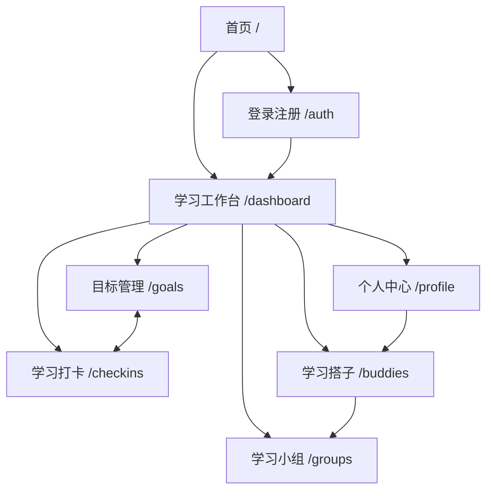
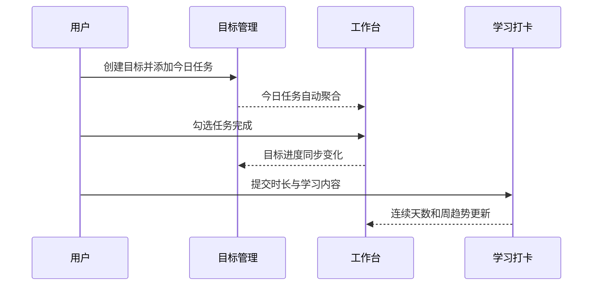
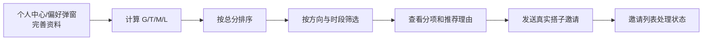

# 学搭网站信息架构与页面设计

> 本文定义第一阶段八个主要页面的结构、导航关系、关键状态、响应式和可访问性要求。

## 1. 信息架构



### 1.1 全局导航

桌面端使用固定左侧导航，顺序为：学习工作台、目标管理、学习打卡、学习搭子、学习小组、个人中心。侧栏底部显示今日任务完成度和用户入口。

第六阶段新增全站顶部铃铛与受保护路由`/notifications`，手机端同样可进入。通知中心分页展示八类搭子/小组事件、未读筛选、单条/全部已读和相关业务导航；搭子页复用列表与全站未读计数。只启动一套可见/在线时的60秒HTTP轮询，打开通知中心刷新列表。通知跳转不授予额外成员或数据权限。

移动端使用：

- 顶部栏：品牌、完整菜单入口、个人头像。
- 底部栏：六个登录后主页面，当前页面有文字和色彩双重状态。
- 抽屉菜单：完整中文页面名称及“本地原型”说明。

首页和认证页不使用应用侧栏：首页保留营销导航；认证页使用沉浸式双栏布局。

### 1.2 导航规则

- 所有核心页面使用稳定、可复制的 URL，不依赖弹窗才能进入。
- 切换路由后滚动到顶部并更新浏览器标题。
- 不存在的路径进入中文 404 页面，可返回工作台。
- 第一阶段不设置虚假路由守卫；真实认证守卫在第二阶段实现。

## 2. 页面清单

| # | 页面 | 路由 | 核心任务 | 主要入口 |
| --- | --- | --- | --- | --- |
| 1 | 首页 | `/` | 理解产品并开始体验 | 直接访问、品牌 Logo |
| 2 | 登录注册 | `/auth` | 表单校验、进入原型 | 首页 CTA |
| 3 | 学习工作台 | `/dashboard` | 决定今天做什么 | 登录后默认页、侧栏 |
| 4 | 目标管理 | `/goals` | 管理目标与任务 | 侧栏、工作台任务/进度 |
| 5 | 学习打卡 | `/checkins` | 记录和回顾学习 | 侧栏、工作台“去打卡” |
| 6 | 学习搭子 | `/buddies` | 真实推荐、筛选、分项解释 | 侧栏、工作台推荐卡 |
| 7 | 学习小组 | `/groups`、`/groups/:groupId` | 发现、创建、审核和共学详情 | 侧栏、打卡分享入口 |
| 8 | 个人中心 | `/profile` | 完善档案和原型数据管理 | 侧栏底部、头像 |

## 3. 页面详细结构

### 3.1 首页

**目标**：在一次自然向下浏览中完成“理解痛点 → 看到产品闭环 → 理解匹配特色 → 开始体验”。

页面结构：

1. 顶部导航：品牌、核心功能、如何开始、智能匹配、登录、免费开始。
2. 首屏 Hero：口号、简短价值说明、主要/次要 CTA、原型边界说明。
3. 工作台视觉预览：今日任务、目标进度、周趋势、搭子与打卡反馈。
4. 四个核心功能：目标管理、学习打卡、搭子匹配、学习小组。
5. 三步使用流程：设定目标 → 记录投入 → 连接同行者。
6. 可解释匹配专题：公式、四个维度和匹配关系示意。
7. 最终 CTA 与页脚。

关键交互：锚点导航、注册入口、查看原型、移动菜单。

状态：无登录状态依赖；所有演示数据均为明确的界面示意，不作为真实运营数据。

### 3.2 登录注册页

**目标**：使用用户名/邮箱和密码完成真实注册、登录与退出。

页面结构：

- 左侧（桌面）：产品价值、三项收益、学习陪伴理念。
- 右侧：登录/注册切换，用户名、邮箱、密码、确认密码表单与安全提示。
- 移动端：隐藏介绍侧栏，保留品牌与完整表单。

关键交互：

- 注册成功后切回登录表单，不伪造自动登录。
- 登录可输入用户名或邮箱；成功后跳回原本要访问的业务路由。
- 刷新时通过 `/auth/me` 恢复身份；未登录不得进入工作台。
- 退出后撤销服务端会话并回到登录页。

### 3.3 学习工作台

**目标**：帮助用户在几秒内回答“今天做什么、进展如何、下一步去哪里”。

页面结构：

1. 日期、问候语和“去打卡”主操作。
2. 数据卡：今日任务、连续天数、本周专注、进行中目标。
3. 今日任务：任务名称、所属目标、预计时长、完成状态、今日总进度。
4. 今日专注卡：环形完成度和下一步提示。
5. 高匹配搭子摘要。
6. 本周学习柱状图。
7. 进行中目标进度。

关键交互：任务勾选/取消，快速进入目标、打卡和搭子页。任务状态与目标进度立即联动并持久化。

空状态：当日无任务时，引导前往目标管理添加任务。

### 3.4 目标管理页

**目标**：管理长期方向与可执行任务，而不是只显示一个手动进度条。

页面结构：

- 总览条：目标总数、进行中数量、已完成任务数。
- 状态筛选：全部、进行中、已完成、已暂停。
- 目标卡片：方向、标题、说明、标签、进度、目标日期、剩余天数、任务数。
- 创建目标卡片。
- 目标编辑弹窗：基本信息、起止日期、标签、颜色、状态。
- 任务管理弹窗：任务列表、完成状态、名称、截止日期、预计时长及增删改。

关键交互：创建、编辑、删除目标；添加、编辑、删除、勾选任务。删除目标需确认。

业务反馈：目标进度由任务完成比例计算；超期目标以文字和颜色提示。

### 3.5 学习打卡页

**目标**：既能快速提交，又能通过日历和历史记录获得积累感。

页面结构：

- 指标卡：连续打卡、本月天数、本月时长、累计时长。
- 月历：已打卡日期、当前选择、未来日期差异。
- 日期详情：当天累计、记录次数、每条学习内容和状态。
- 最近记录时间线。
- 打卡弹窗：关联目标、学习时长、内容、学习状态。

关键交互：选择日期、返回今天、提交同日多段学习。

边界状态：未来日期禁止提交；无记录显示补打卡入口；同日多条记录累计但连续天数只算一天。

### 3.6 学习搭子页

**目标**：根据真实数据库档案提供可信、可解释的学习搭子推荐。

页面结构：

1. 当前匹配档案摘要与公式权重。
2. 刷新推荐、前往个人中心设置匹配偏好。
3. 搜索与筛选：公开昵称/标签、方向、时段、星期、只看共同空闲时间。
4. 候选卡：公开昵称、方向/目标、方式/阶段、可用时段、匹配分、实际重合分钟、推荐理由及缺失说明。
5. 匹配详情抽屉：G/T/M/L 分项分和解释。
6. 服务端总数、分页和加载/失败重试/空数据状态。
7. 邀请弹窗：留言和共享范围说明；按钮按真实状态显示“申请成为搭子/等待接受/已成为搭子/处理对方邀请”。
8. 收到/已发送邀请：分页、状态筛选、公开资料、接受/拒绝/取消及终态。
9. 我的搭子：双方可见的有效关系、学习计划、解除确认。
10. 通知入口：未读角标、事件列表、已读与相关列表导航；普通 HTTP 查询和手动刷新。

关键交互：在个人中心保存档案和邀请开关后刷新推荐；筛选、发送邀请、接收方处理、双方查看关系、解除及通知。所有邀请/关系状态以服务端响应为准，不乐观伪造成功。工作台推荐摘要来自同一真实接口。

隐私边界：仅展示主动开启匹配的用户，排除本人和禁用账号；无邮箱、学校、专业、简介、打卡统计或在线状态；缺失资料显示中性分说明；无重合明确提示。匹配数据不写 LocalStorage。

### 3.7 学习小组页

**目标**：围绕共同方向发现小组，并快速判断规模、节奏和加入门槛。

页面结构：

- 主题 Hero 与当前小组概览。
- Tab：发现小组、我加入的。
- 搜索与方向筛选。
- 小组卡：方向、加入方式、简介、标签、容量、组长公开昵称和本人状态。
- 创建小组弹窗。
- 小组详情页 `/groups/:groupId`：公开预览与加入门槛；入组后显示公告、今日/本周/累计指标、七日足迹、成员公开动态、四类排行榜和共同目标的本人进度。
- 组长可编辑信息、审核/拒绝申请、移除成员、转让组长、设置目标及明确解散。
- 在个人“学习打卡”的现有记录上点击“分享到小组”，逐组授权日期/时长，正文默认不公开，可修改授权或撤回。

关键交互均通过真实 FastAPI：创建、直接加入/待审核、本人取消申请、组长批准/拒绝、成员退出、分享/撤回、刷新统计。浏览/搜索、申请、动态均支持服务端分页。

边界状态：未登录重定向；未入组只见公开摘要；审核中不能查看成员私有内容；满员不可新加入；组长先转让再退出或明确解散。普通组员的管理请求由后端拒绝。加载失败可重试，空列表不填充假成员或排行榜；退出/移除撤回分享但保留个人打卡。

### 3.8 个人中心

**目标**：统一管理数据库持久化的本人档案、匹配输入、学习作息和隐私开关。

页面结构：

- 档案头部：头像、身份资料、简介、连续天数、累计时长、目标数。
- 基本资料：公开昵称；学校、专业、简介仅本人可见。
- 学习方向：分类、标签、阶段、方式。
- 可用时间：星期、开始和结束时间，可增删多个时段。
- 偏好：允许被推荐、接收搭子邀请（均默认关闭）、每日目标时长；打卡提醒暂不可用。
- 账号与安全：当前用户名/邮箱展示、安全退出。
- 数据与隐私：说明服务端持久化与打卡分享范围；仅在显式个人 Mock 模式提供个人演示重置，小组始终使用真实 API。

关键交互：进入/取消编辑、通过本人 API 保存、增删时间段（UTC+8）、修改公开推荐开关。失败保留表单并提示；刷新恢复数据库档案，切换账号清除旧内存缓存。

## 4. 核心跨页面流程

### 4.1 目标到打卡闭环



### 4.2 搭子匹配流程



### 4.3 小组参与流程

```text
发现小组 → 搜索/筛选 → 查看小组详情
  ├─ 直接加入 → 成为真实组员
  ├─ 申请加入 → 等待组长审核 → 批准后成为组员（可拒绝/本人取消）
  └─ 创建小组 → 自动成为组长 → 设置共同目标、审核和管理成员
成为组员 → 完成个人打卡 → 选择分享到本组（正文另行授权）
  → 查看动态与真实排行榜 → 查看自己的目标进度
普通成员退出/被移除 → 本组分享撤回 → 个人记录保留
组长离开 → 先转让给现有成员再退出，或明确解散小组
```

## 5. 统一 UI/UX 规范

### 5.1 视觉语言

- 主色：蓝紫 `#5B5CE2`，用于主要操作、当前导航和进度。
- 辅色：青绿用于专注/成功，橙色用于连续天数/提醒，红色仅用于危险操作。
- 背景：`#F7F8FC`，内容面板为白色；避免大面积纯灰造成沉闷。
- 圆角：输入和按钮 10–11px，卡片 18–22px，强调容器 22–28px。
- 阴影：只用于层级浮起和重点容器，普通卡片以细边框为主。
- 字体：优先系统中文字体；标题紧凑，正文行高 1.6–1.85。

### 5.2 组件状态

- 按钮：主要、次要、文本、危险、禁用、加载状态统一。
- 表单：标签置顶，错误就近展示；必填项不能只靠占位符说明。
- 标签：方向、状态、推荐等级使用胶囊样式，但必须保留文字。
- 反馈：成功使用轻量消息；高影响操作使用确认对话框。
- 空状态：解释为什么为空，并提供唯一明确的下一步按钮。
- 弹窗：用于创建/编辑；抽屉用于查看信息丰富的详情，避免多层弹窗。

## 6. 响应式策略

| 宽度 | 布局策略 |
| --- | --- |
| ≥ 1180px | 完整侧栏，多列数据卡，业务卡片 3 列 |
| 820–1179px | 紧凑侧栏，卡片 2 列，主次栏按需要堆叠 |
| < 820px | 顶栏 + 底部导航，主内容单列 |
| < 620px | 紧凑间距，数据卡 2 列，表单/弹窗单列，日历单元缩小 |

移动端保留全部核心功能；次要装饰可隐藏，但不能隐藏提交、编辑、删除、筛选和状态说明。

## 7. 可访问性与键盘操作

- `Tab` 可依次访问导航、筛选、卡片操作、表单和弹窗按钮。
- `Enter` 可提交登录、任务名称等明确表单；危险操作仍需确认。
- Tab、筛选按钮和颜色选择器使用 `aria-selected`/`aria-checked`。
- 当前导航使用 `aria-current="page"`。
- 装饰图形从辅助技术中隐藏；图表提供可读标题与具体数值。
- 焦点环全局可见；减少动态效果设置下关闭非必要动画。
- 页面主内容具有稳定 `main` 入口和可跳转的 skip link。
